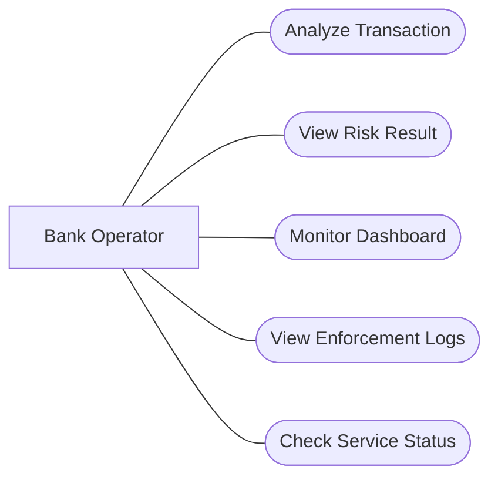

# Use Case - Fraud Detection System

## Actor
Bank Operator - Nhan vien van hanh ngan hang.

## Main Use Cases
- Submit transaction for fraud analysis.
- View fraud detection results.
- Monitor transaction dashboard.
- View risk scores and transaction status.
- Monitor system service status.
- View enforcement logs.

## Use Case Overview

